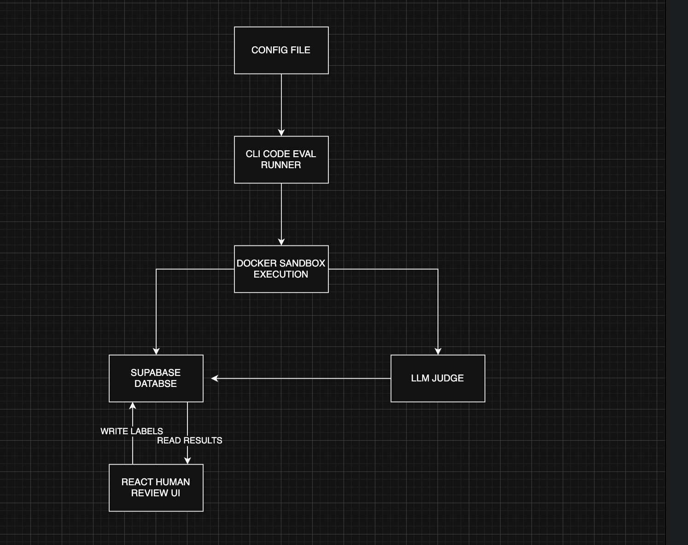

# Multi-Agent Code Evaluator

A pipeline for evaluating code written by open-source LLMs. It asks coding models to solve algorithm problems, runs each answer in an isolated Docker sandbox against test cases, scores the results, and uses a stronger LLM as a judge to pick the better of two correct solutions.



## How it works

```
CLI runner -> question set -> Model A + Model B -> Docker sandbox -> scoring -> LLM judge -> Supabase + MLflow
```

1. **Run an experiment.** A YAML config chooses the models, the question filter (difficulty, topic), prompt versions, and whether the judge is on. One CLI run is one experiment.
2. **Generate solutions.** Each selected model (via the Hugging Face Inference API) solves each question.
3. **Execute safely.** Generated code runs in a locked-down container against the question's test cases.
4. **Score.** Each answer gets a problem score from its pass rate, whether it ran without errors, and its runtime. Models are ranked per question and aggregated per run, including a stability measure.
5. **Judge.** For pairs of solutions, a larger model picks a winner (A or B) on algorithmic clarity, efficiency, and implementation quality, and returns a confidence value and a short reason.
6. **Store and track.** Results go to Supabase (Postgres). Run-level metrics are logged to MLflow.

## Sandbox safety

Model-generated code is untrusted, so each submission runs in a throwaway container with:

- no network access
- 256 MB memory and 0.5 CPU limits
- a 64-process limit and a 2-second timeout
- a read-only filesystem (with a small tmpfs)
- all Linux capabilities dropped and `no-new-privileges`
- a non-root user inside the image

## Scoring

| Level | What it measures |
|---|---|
| Problem score (model x question) | 70% correctness (pass rate + clean execution), 30% runtime |
| Run score (model x run) | Mean problem score, runtime, and stability across questions |
| Judge result (question) | Winner, confidence, reason |

## Project structure

```
Backend/          run.py (CLI), evaluation.py, llm_judge.py, prompts/, FastAPI app
infra/
  sandbox/        Dockerfile, executor, sandbox runner
  models/         Hugging Face client, model registry, scoring
  aggregation/    run-level scoring and stability
  observability/  MLflow logger
configs/          experiment configs (config_v1.yaml)
frontend/         React + TypeScript dashboard (in progress)
```

## Getting started

Requires Python 3.9+, Docker, a Hugging Face API key, and a Supabase project.

```bash
# 1. Build the sandbox image
docker build -t python-sandbox infra/sandbox

# 2. Add credentials to .env
#    HF_API_KEY=...
#    SUPABASE_URL=...
#    SUPABASE_KEY=...

# 3. Run an experiment
python run.py --config configs/config_v1.yaml
```

MLflow and the API can be started with `docker compose up`.

## Tech stack

Python, Docker, Hugging Face Inference API, Supabase, MLflow, FastAPI, React + TypeScript

## Status and roadmap

- [x] Docker sandbox and test-case execution
- [x] Problem scoring and ranking
- [x] LLM judge (pairwise)
- [x] Config-driven CLI runs
- [ ] Run-level metrics logged to MLflow
- [ ] Larger question set (currently 5 seed questions)
- [ ] CI check against saved model responses
- [ ] Dashboard

## References

- [Demystifying evals for AI agents (Anthropic)](https://www.anthropic.com/engineering/demystifying-evals-for-ai-agents)
- [Preference data (RLHF Book)](https://rlhfbook.com/c/11-preference-data)
- [Agentic engineering patterns (Simon Willison)](https://simonwillison.net/guides/agentic-engineering-patterns/)